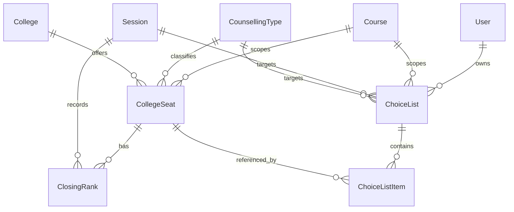

# NEET Advisor Portal — Choice List & Counselling System Architecture

> **Status:** Draft Design Document (Not Yet Implemented)  
> **Scope:** Master College/Cutoff Data + User-Specific Choice List Builder (UG / PG Counselling)

---

## 1. Overview

In NEET medical counselling (MCC All India Quota, State Counselling, Deemed Universities, and Open Private States), final seat allotment depends strictly on the **priority order (`1, 2, 3, ...`)** of choices filled by the student.

The **Choice List** module lets students and advisors:
- Explore verified **Colleges, Seat Quotas, Fees, Stipends, Bonds, and Historical Closing Ranks**.
- Build **multiple preference lists** (e.g., *AIQ Round 1*, *UP State Round 1*, *Deemed Backup*).
- Generate a **rank-, category-, domicile-, and budget-aware starter list** automatically or build one manually.
- Reorder choices (`priorityOrder`), tag admission chances (*Dream / Realistic / Safe*), get **Advisor review**, and export to **PDF / Excel** before filling choices on official portals.

---

## 2. Integration with Existing Codebase Entities

This design reuses the existing normalized lookup and user tables already present in the project:

| Existing Entity | Path | Role in Choice List System |
| :--- | :--- | :--- |
| `User` | `src/modules/users/entities/user.entity.ts` | Provides `id`, `state` (default domicile), and `course` (`UG` / `PG`) |
| `Course` | `src/modules/courses/entities/course.entity.ts` | Scopes lists and colleges by `UG` / `PG` |
| `Session` | `src/modules/sessions/entities/session.entity.ts` | Tracks counselling academic year (`2025`, `2026`, etc.) |
| `CounsellingType` | `src/modules/counselling-types/entities/counselling-type.entity.ts` | Maps quotas (`All India Quota`, `State Quota`, `Deemed / Central`, `Management / NRI`) |

---

## 3. Data Architecture

### Entity Relationship Overview



### Layer 1: Master College & Cutoff Data

#### 1.1 `colleges`
Stores institute-level details:
- `id` (`uuid`, PK)
- `name`, `shortName`, `slug`
- `state`, `city`
- `instituteType` (`GOVT` | `PRIVATE` | `DEEMED` | `AIIMS` | `ESIC` | `AFMC`)
- `establishedYear`, `bedsCount`
- `universityName`, `website`
- `isActive` (`boolean`)

#### 1.2 `college_seats` (College × Course × Specialty × Quota)
> **Why not link Choice Lists directly to `colleges`?**  
> A single college can offer multiple branches (especially in PG) and multiple quotas (e.g., *State Govt Seat* vs *Management Seat* vs *NRI Seat*) with completely different fees and cutoffs.

- `id` (`uuid`, PK)
- `collegeId` (`FK -> colleges`)
- `courseId` (`FK -> courses` — e.g., `UG`, `PG`)
- `programName` (e.g., `MBBS`, `BDS`, `MD General Medicine`, `MS Orthopaedics`)
- `counsellingTypeId` (`FK -> counselling_types`)
- `quotaName` (e.g., `AIQ 15%`, `State 85%`, `Deemed Paid`, `NRI`)
- `annualTuitionFee` (`int`), `hostelFee` (`int`, nullable), `totalSeats` (`int`, nullable)
- `bondYears` (`int`), `bondPenalty` (`bigint`, nullable)
- `stipendAmount` (`int`, nullable — primarily for PG)
- `isOpenState` (`boolean` — whether non-domicile students can apply)

#### 1.3 `closing_ranks` (Historical Cutoffs)
Stores round-by-round previous year cutoffs for rank matching and chance calculation:
- `id` (`uuid`, PK)
- `collegeSeatId` (`FK -> college_seats`)
- `sessionId` (`FK -> sessions` — e.g., `2025`, `2024`)
- `round` (`ROUND_1` | `ROUND_2` | `ROUND_3` | `STRAY`)
- `candidateCategory` (`GEN` | `EWS` | `OBC` | `SC` | `ST` | `PWD`)
- `openingRank` (`int`, nullable)
- `closingRank` (`int`)
- `closingScore` (`int`, nullable)

---

### Layer 2: User Choice List Data

#### 2.1 `choice_lists` (List Header)
- `id` (`uuid`, PK)
- `userId` (`FK -> users`)
- `createdByAdvisorId` (`FK -> users`, nullable — populated if advisor-curated)
- `title` (e.g., `"AIQ + Deemed Round 1"`)
- `courseId` (`FK -> courses`)
- `sessionId` (`FK -> sessions`)
- `counsellingTypeId` (`FK -> counselling_types`, nullable for mixed lists)
- `round` (`ROUND_1` | `ROUND_2` | `ROUND_3` | `STRAY`)
- **Criteria Snapshot used to build/evaluate the list:**
  - `neetRank` (`int`)
  - `candidateCategory` (`GEN` | `EWS` | `OBC` | `SC` | `ST` | `PWD`)
  - `domicileState` (`varchar`)
  - `maxAnnualBudget` (`int`, nullable)
- `status` (`DRAFT` | `SAVED` | `REVIEWED` | `LOCKED`)
- `version` (`int`, default `1` — prevents stale overwrites when edited across multiple devices)
- `lastSavedAt` (`timestamp`, nullable)
- `createdAt`, `updatedAt`

#### 2.2 `choice_list_items` (Ordered Preferences)
- `id` (`uuid`, PK)
- `choiceListId` (`FK -> choice_lists`, `ON DELETE CASCADE`)
- `collegeSeatId` (`FK -> college_seats`)
- `priorityOrder` (`int` — `1, 2, 3, ...`, unique per list or managed atomically on reorder)
- `chanceTag` (`DREAM` | `REALISTIC` | `SAFE` | `UNKNOWN`)
- `notes` (`text`, nullable — student or advisor remark)
- `createdAt`, `updatedAt`

---

## 4. How a Choice List Is Built for a User

### Step 1: Resolve User Criteria
1. **Course Scoping:** Automatically taken from `User.course` (`UG` or `PG`) via the authenticated JWT user.
2. **Domicile State:** Defaults to `User.state`, overridable per choice list if needed.
3. **Counselling Inputs:** `neetRank`, `candidateCategory`, `maxAnnualBudget`, `counsellingType` / preferred states.

### Step 2: Eligibility & Filtering Pipeline
When filtering colleges or auto-generating a list, the backend applies rules in order:
1. **Course Match:** `collegeSeat.courseId === user.courseId`
2. **Quota & State Eligibility:**
   - `AIQ` & `Deemed`: Available to all students regardless of domicile.
   - `State Govt Quota`: `college.state === criteria.domicileState`.
   - `Open Private / Management`: `collegeSeat.isOpenState === true` OR `college.state === criteria.domicileState`.
3. **Budget Filter:** If `maxAnnualBudget` is set, `collegeSeat.annualTuitionFee <= maxAnnualBudget`.
4. **Category Cutoff Lookup:** Match `closing_ranks` for `criteria.candidateCategory` (and optionally `GEN`/`OPEN` fallback where applicable).

### Step 3: Rank Window & Chance Tagging
Given a user's `neetRank` and the reference session's `closingRank` (typically previous year's matching round):

| Tag | Typical Rank Window | Meaning in Choice Order |
| :--- | :--- | :--- |
| **`DREAM`** | `closingRank` is `~50%` to `90%` of `userRank` (e.g., Rank `15,000` vs Cutoff `8,000–13,500`) | Stretch options placed **at the top** of the list |
| **`REALISTIC`** | `closingRank` is `~90%` to `120%` of `userRank` (e.g., Rank `15,000` vs Cutoff `13,500–18,000`) | Strong probability targets in the **middle** |
| **`SAFE`** | `closingRank` is `> 120%` of `userRank` (e.g., Rank `15,000` vs Cutoff `18,000+`) | Safe backups placed **below** targets |

*(Exact percentage thresholds can be configured in service constants.)*

---

## 5. Supported Choice-Building Modes

1. **Manual Shortlist:**
   - Student browses **Closing Ranks / College Explorer** and clicks `+ Add to Choice List`.
   - Reorders items via drag-and-drop (`priorityOrder` updates atomically in a DB transaction).
2. **Auto-Generate Starter List:**
   - Student enters `neetRank`, `candidateCategory`, `domicileState`, `maxAnnualBudget`, and preferred quotas.
   - Backend selects eligible `college_seats` in the `DREAM → REALISTIC → SAFE` rank window, sorts by `closingRank ASC` (highest-demand colleges first), inserts up to `N` choices (e.g., top 50–100), and lets the student customize from there.
3. **Advisor-Curated List:**
   - Admin/Advisor creates or edits a `choice_list` for a student, adds notes, marks `status = REVIEWED`, and the student views/locks/exports it.

---

## 6. Cross-Device Save & Sync Flow

Because the portal supports multi-device login (`user_devices`, up to 3 active devices per user), **all choice lists must be persisted in PostgreSQL keyed by `userId` (`req.user.sub` from JWT)** — never only in client `localStorage` or device memory.

### How It Works Across Devices
1. **Create & Save (`POST /choice-lists`):**
   - When a user creates a choice list on **Device A** (e.g., Mobile App), it can be saved empty or with initial `items[]` directly in PostgreSQL under `userId`.
2. **Explicit Save / Sync (`PUT /choice-lists/:id/save`):**
   - While editing (adding/removing colleges, dragging to reorder, adding notes, updating title/criteria), the client sends the full ordered list to `PUT /choice-lists/:id/save`.
   - Inside a **single PostgreSQL transaction**:
     1. Verifies ownership (`choiceList.userId === req.user.sub`) and checks `status !== 'LOCKED'`.
     2. Checks optimistic lock (`client.version === db.version`) so an older tab/device cannot silently overwrite newer edits made on another device (returns `409 Conflict` if stale).
     3. Updates list metadata (`title`, criteria snapshot, `status = 'SAVED'`, `lastSavedAt = now()`, `version = version + 1`).
     4. Atomically syncs `choice_list_items` with sequential `priorityOrder` (`1, 2, 3, ...`) and recalculated `chanceTag`.
3. **Open on Another Device (`GET /choice-lists` & `GET /choice-lists/:id`):**
   - When the same user signs in on **Device B** (e.g., Web Browser or another phone) using the **same account (`userId`)**, `GET /choice-lists` automatically fetches all their saved choice lists from PostgreSQL, and `GET /choice-lists/:id` loads the exact saved priority order, notes, criteria, and `version`.

#### Sample Save Request (`PUT /choice-lists/:id/save`)
```json
{
  "title": "AIQ + Deemed Round 1",
  "version": 2,
  "neetRank": 14850,
  "candidateCategory": "OBC",
  "domicileState": "Maharashtra",
  "maxAnnualBudget": 1500000,
  "items": [
    { "collegeSeatId": "uuid-seat-1", "priorityOrder": 1, "notes": "Top preference" },
    { "collegeSeatId": "uuid-seat-2", "priorityOrder": 2, "notes": "Low bond" }
  ]
}
```

---

## 7. Proposed API Endpoints (Reference)

### Master Explorer (`/colleges`, `/cutoffs`)
| Method | Endpoint | Access | Purpose |
| :--- | :--- | :--- | :--- |
| `GET` | `/colleges` | Authenticated | Search/filter colleges & seats (course-scoped by token, state, quota, fee, bond) |
| `GET` | `/colleges/:id` | Authenticated | Full college details, seat types, fees, bond, stipend, and multi-year cutoffs |
| `GET` | `/cutoffs` | Authenticated | Closing ranks explorer + "Rank Scan" around user's `neetRank` |
| `POST` | `/admin/colleges/import` | Admin | Bulk import colleges, seat matrices, and closing ranks via `.xlsx` / `.csv` |

### Choice Lists (`/choice-lists`)
| Method | Endpoint | Access | Purpose |
| :--- | :--- | :--- | :--- |
| `GET` | `/choice-lists` | Authenticated | List all saved choice lists belonging to `req.user.sub` (synced across all devices) |
| `POST` | `/choice-lists` | Authenticated | Create & save a new choice list (accepts criteria snapshot + optional initial `items[]`) |
| `POST` | `/choice-lists/auto-generate` | Authenticated | Generate & save a `Dream → Realistic → Safe` starter list from rank/category/state/budget |
| `GET` | `/choice-lists/:id` | Authenticated | Fetch saved choice list by ID with ordered items, fees, cutoffs, `chanceTag`, and `version` |
| `PUT` | `/choice-lists/:id/save` | Authenticated | **Save / sync** full choice list (header + ordered `items[]`) atomically with optimistic `version` check |
| `POST` | `/choice-lists/:id/items` | Authenticated | Append one or more `collegeSeatId` entries to the saved list |
| `PATCH` | `/choice-lists/:id/reorder` | Authenticated | Persist drag-and-drop `priorityOrder` updates transactionally |
| `DELETE` | `/choice-lists/:id/items/:itemId` | Authenticated | Remove an item and re-sequence remaining `priorityOrder` values |
| `POST` | `/choice-lists/:id/duplicate` | Authenticated | Clone a saved list (e.g., Round 1 → Round 2) |
| `GET` | `/choice-lists/:id/export` | Authenticated | Export ordered choice list as `.xlsx` or `.pdf` |

---

## 8. Decisions to Confirm Before Implementation

- [ ] **Phase 1 Scope:** Start with Master Colleges + Closing Ranks + Manual Choice Lists, or include Auto-Generate in Phase 1?
- [ ] **Data Ingestion:** Will college/cutoff data be bulk-imported via Excel/CSV (similar to `POST /users/import`)?
- [ ] **UG vs PG Differences:** Do we need `stipendAmount` and `programName` (MD/MS specialties) in Phase 1, or UG (`MBBS`/`BDS`) first?
- [ ] **Advisor Flow:** Can admins/advisors create and push reviewed choice lists directly to students?
- [ ] **Export Format:** Excel (`.xlsx`, using already-installed `exceljs`) only, or PDF as well?
